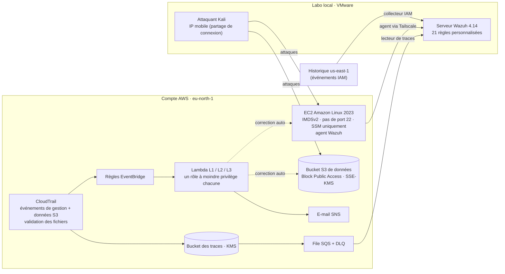

# Laboratoire de sécurité cloud AWS — Détecter, contenir, rapporter

> 🇬🇧 [English version](README.md)

Un projet pratique de sécurité cloud : j'ai construit une petite entreprise fictive sur **un vrai compte AWS**, je l'ai attaquée avec des scénarios cloud réalistes, j'ai **détecté** les attaques avec un **SIEM Wazuh** auto-hébergé, je les ai **contenues** (automatiquement par Lambda pour les erreurs de configuration, manuellement avec un runbook ISO 27035 pour la fuite d'identifiants) et j'ai **mesuré** chaque étape.

**Axes :** Réponse à incident · Ingénierie de détection · Sécurité cloud · GRC
**Outils :** AWS (EC2, S3, KMS, IAM, CloudTrail, EventBridge, Lambda, SQS, SNS, SSM) · Terraform · Wazuh 4.14 · Python · PowerShell · Kali Linux · Prowler (CIS AWS 7.0)

> ⚠️ **Usage laboratoire uniquement.** Ce dépôt contient volontairement des options qui créent des configurations non sécurisées (bucket public, SSH ouvert à Internet, IMDSv1). À exécuter uniquement dans un compte isolé qui vous appartient. Les données sont synthétiques (Faker). L'identifiant du compte AWS est masqué par l'exemple de la documentation AWS `111122223333`.

---

## Résultats clés (exécutions réelles, 24/10/2026)

| Scénario | Détection (Wazuh) | Confinement | Temps de confinement |
|---|---|---|---|
| **S3 – SSH ouvert à 0.0.0.0/0 + force brute** — manuel | agent : ~40 s · CloudTrail : 4 min 46 s | retour arrière Terraform | 7 min 57 s |
| **S3** — automatisé (Lambda L2) | CloudTrail : 2 min 37 s | règle du groupe de sécurité révoquée | **5,3 s** |
| **S1 – Bucket S3 public + lecture anonyme** — manuel | changement de config : ~3 min · lecture des données : 3 min 34 s | retour arrière Terraform | ~8 min |
| **S1** — automatisé (Lambda L1) | 1 min 29 s | Block Public Access réactivé | **9,9 s** |
| **S2 – Clé d'accès CI divulguée + persistance** — réponse manuelle | 3 min 41 s (usage de la clé) · alerte persistance niveau 14 | `AWSDenyAll`, clés désactivées (runbook ISO 27035) | 6 min 23 s (2 min 42 s après l'alerte) |
| **IMDSv1 réactivé** — automatisé (Lambda L3) | 1 min 23 s | IMDSv2 imposé | **6,4 s** |

- **Le confinement automatisé est environ 50 à 90 fois plus rapide que le manuel** (5–10 s contre 6–8 min), et dans la plupart des cas il a corrigé le problème **avant même que le SIEM ne le voie**.
- **La défense en profondeur a tenu :** la copie chiffrée par KMS n'a pu être lue ni anonymement ni avec la clé divulguée (pas de `kms:Decrypt`) ; la force brute SSH a échoué car l'instance n'accepte que les clés / SSM.
- **Le SIEM a rattrapé ce que l'automatisation a manqué :** lors d'une exécution, la règle EventBridge activée 40 s plus tôt ne s'est pas déclenchée — Wazuh a quand même levé l'alerte de lecture anonyme en ~1 min.
- **Intégrité des preuves :** chaque exécution a son dossier de preuves avec empreintes SHA-256 ; la validation des fichiers CloudTrail a réussi (1/1 digest, 17/17 fichiers) sur toute la fenêtre d'attaque.
- **CIS AWS 7.0 (Prowler) :** 53,33 % au départ → 57,14 % pendant les attaques (voir *Constats* : pourquoi le score a *augmenté*) → analyse après durcissement prévue en phase 5.

---

## Architecture



**Pourquoi cette conception**
- **Pas de GuardDuty / Security Hub** (indisponibles avec l'offre du compte) → toutes les détections sont écrites à la main sous forme de règles Wazuh sur les données CloudTrail.
- **IAM est un service global journalisé uniquement en us-east-1** : une trace régionale ne voit jamais `CreateAccessKey`. Un petit collecteur lit l'historique us-east-1 pour combler ce manque.
- **Le lecteur S3 standard de Wazuh ignorait les fichiers CloudTrail arrivés en retard** (il mémorise le dernier nom de fichier, et les fichiers d'événements de données peuvent arriver dans le désordre) — un `GetObject` anonyme a été perdu sans bruit pendant les tests. Remplacé par une **notification S3 → SQS + lecteur** qui traite les fichiers dans l'ordre d'arrivée.
- **Tout est en Terraform avec des options de scénario** (`insecure_bucket`, `ssh_open`, `imds_v1`, `lambdas_enabled`), testé d'abord sur LocalStack, détruit après chaque session. **Aucun secret dans l'état Terraform** (la clé CI et la clé Tailscale sont créées à la main).

---

## Scénarios

| # | Type | Déroulé | Règles Wazuh | Réponse |
|---|---|---|---|---|
| **S1** | Erreur de configuration | Bucket rendu public, fichier clients téléchargé anonymement avec `curl` | 100100–100104 (BPA retiré/désactivé, politique publique, lecture anonyme, lecture anonyme refusée) | Lambda **L1** réactive Block Public Access (avec garde anti-boucle) |
| **S2** | Attaque | Une clé CI est commitée puis « supprimée » dans l'historique Git ; **TruffleHog** la trouve ; l'attaquant lit les données et **crée une seconde clé** (persistance) | 100110 clé utilisée depuis une IP inconnue · **100113 (niveau 14)** la clé divulguée crée une clé | **Réponse manuelle** — [`runbooks/leaked-key.md`](runbooks/leaked-key.md) |
| **S3** | Erreur + attaque | Port 22 ouvert à Internet, puis force brute SSH | 100120/100121 groupe de sécurité ouvert à Internet · 5710/5712 sshd | Lambda **L2** révoque toute règle entrante ouverte à Internet |
| **M-IMDS** | Erreur de configuration | IMDSv1 réactivé sur l'instance | 100132 | Lambda **L3** impose IMDSv2 |

Toutes les attaques ont suivi des **[règles d'engagement](runbooks/rules-of-engagement.md)** écrites (périmètre, techniques autorisées, limites de débit, conditions d'arrêt) et la politique AWS de tests d'intrusion. MITRE ATT&CK : T1530, T1078.004, T1098.001, T1110, T1562.007/.008.

---

## Constats et leçons apprises

1. **Une automatisation doit être armée avant d'être fiable.** Une règle EventBridge activée 40 s avant le changement n'a rien intercepté ; une trace toute neuve perd aussi ses premiers événements. → Procédure : attendre ≥ 60 s après l'activation des règles, ≥ 5 min après la création d'une trace.
2. **Les scores en pourcentage trompent.** Le score CIS de Prowler a *augmenté* alors qu'un bucket était public, car de nouvelles ressources ont ajouté des contrôles conformes. Suivre les écarts critiques contrôle par contrôle, pas le pourcentage.
3. **SSH par clé uniquement neutralise la force brute par mot de passe** (Hydra s'arrête : pas d'authentification par mot de passe) — une mesure compensatoire à inscrire au registre des risques.
4. **Les noms IAM sont réutilisables, les identifiants non.** Une recherche par `userName` a remonté un événement d'un ancien utilisateur du même nom ; une investigation doit s'appuyer sur l'identifiant du principal.
5. **Les identifiants de clé d'accès révèlent le numéro de compte** (décodable depuis `AKIA…`) : ils sont donc traités comme sensibles dans les rapports publiés.
6. **La collecte fait partie de la détection.** Deux failles du pipeline (événements IAM globaux, fichiers de trace hors ordre) auraient masqué de vraies attaques ; les deux ont été démontrées puis corrigées.

---

## Organisation du dépôt

```
terraform/   VPC, IAM, S3 + KMS, CloudTrail, SQS, EC2 (amorçage : Tailscale + agent Wazuh), SNS, Lambda + EventBridge
lambda/      L1 re-blocage S3 · L2 révocation SG · L3 IMDSv2 imposé (+ événements de test)
wazuh/       local_rules.xml (21 règles) · collecteur IAM · lecteur de traces SQS (+ unités systemd)
iam/         politiques à moindre privilège pour le lecteur de journaux et l'utilisateur CI
scripts/     données fictives, analyse des traces, tests Lambda sur LocalStack, utilitaires IP, mise en place de la fuite S2
runbooks/    leaked-key.md (ISO 27035) · rules-of-engagement.md
reports/     timelines.xlsx (journal d'exécution anonymisé) · rapports d'incident et synthèses Prowler (phase 5)
```

---

## Avancement

- [x] Phase 0 — mise en place (sécurisation du compte AWS, VM, outils)
- [x] Phase 1 — socle sécurisé en Terraform + mesure Prowler de départ
- [x] Phase 2 — chaîne de détection + 21 règles Wazuh personnalisées
- [x] Phase 3 — confinement automatisé (3 Lambda) + runbook de réponse + règles d'engagement
- [x] Phase 4 — attaques réelles, mesurées et documentées
- [ ] **Phase 5 — rapports d'incident (ISO 27035), registre des risques, correspondance CIS / ISO 27001 annexe A / ISO 27017, note loi 09-08, durcissement final + Prowler n° 3** *(en cours)*
- [ ] Phase 6 — publication finale

---

## Auteur

**Ziad Abbassi** — élève ingénieur en 5e année, Cybersécurité et Réseaux, EMSI Rabat (Maroc).
À la recherche d'un stage de fin d'études (PFE) en réponse à incident, sécurité cloud ou GRC. · 
[LinkedIn](https://www.linkedin.com/in/ziad-abbassi)
