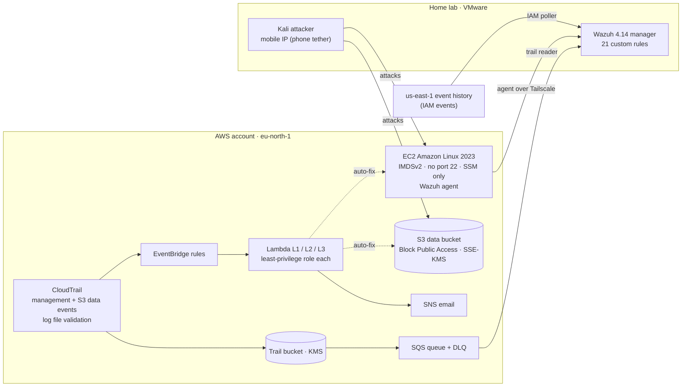

# AWS Cloud Security Lab — Detect, Contain, Report

> 🇫🇷 [Version française](README.fr.md)

A hands-on cloud security project: I built a small fictional company on **real AWS**, attacked it with realistic cloud scenarios, **detected** the attacks with a self-hosted **Wazuh SIEM**, **contained** them (automatically with Lambda for misconfigurations, manually with an ISO 27035 runbook for the credential leak), and **measured** every step.

**Focus:** Incident Response · Detection Engineering · Cloud Security · GRC
**Stack:** AWS (EC2, S3, KMS, IAM, CloudTrail, EventBridge, Lambda, SQS, SNS, SSM) · Terraform · Wazuh 4.14 · Python · PowerShell · Kali Linux · Prowler (CIS AWS 7.0)

> ⚠️ **Lab only.** This repo deliberately contains toggles that create insecure configurations (public bucket, SSH open to the internet, IMDSv1). Run it only in an isolated account you own. The data is synthetic (Faker). The AWS account ID is redacted as AWS's documentation example `111122223333`.

---

## Key results (live runs, 2026-10-24)

| Scenario | Detection (Wazuh) | Containment | Time to contain |
|---|---|---|---|
| **S3 – SSH opened to 0.0.0.0/0 + brute force** — manual | agent: ~40 s · CloudTrail: 4 min 46 s | Terraform revert | 7 min 57 s |
| **S3** — automated (Lambda L2) | CloudTrail: 2 min 37 s | SG rule revoked | **5.3 s** |
| **S1 – Public S3 bucket + anonymous read** — manual | config change: ~3 min · data read: 3 min 34 s | Terraform revert | ~8 min |
| **S1** — automated (Lambda L1) | 1 min 29 s | Block Public Access re-enabled | **9.9 s** |
| **S2 – Leaked CI access key + persistence** — manual IR | 3 min 41 s (key misuse) · persistence alert level 14 | `AWSDenyAll`, keys deactivated (ISO 27035 runbook) | 6 min 23 s (2 min 42 s after the alert) |
| **IMDSv1 re-enabled** — automated (Lambda L3) | 1 min 23 s | IMDSv2 enforced | **6.4 s** |

- **Automated containment is ~50–90× faster than manual** (5–10 s vs 6–8 min), and in most runs it fixed the problem **before the SIEM had even seen it**.
- **Defence in depth held:** the KMS-encrypted copy of the data could not be read anonymously nor with the leaked key (no `kms:Decrypt`); SSH brute force failed because the instance is key-only / SSM-only.
- **The SIEM caught what automation missed:** in one run the EventBridge rule had been enabled only 40 s earlier and never fired — Wazuh still raised the anonymous-read alert within ~1 min.
- **Evidence integrity:** every run has its own evidence folder with SHA-256 hashes; CloudTrail log-file validation passed (1/1 digest, 17/17 log files) for the whole attack window.
- **CIS AWS 7.0 (Prowler):** 53.33 % baseline → 57.14 % during the attacks (see *Findings* for why the score went *up*) → after-hardening scan planned in Phase 5.

---

## Architecture



**Why it is built this way**
- **No GuardDuty / Security Hub** (not available on the account's plan) → all detections are written by hand as Wazuh rules on CloudTrail data.
- **IAM is a global service logged only in us-east-1**, so a regional trail never sees `CreateAccessKey`. A small poller reads the us-east-1 event history to close that gap.
- **The stock Wazuh S3 reader skipped late-arriving CloudTrail files** (it tracks the last file name, and data-event files can arrive out of order) — an anonymous `GetObject` was silently lost in testing. Replaced by an **S3 → SQS notification + reader** that processes files in arrival order.
- **Everything is Terraform with scenario toggles** (`insecure_bucket`, `ssh_open`, `imds_v1`, `lambdas_enabled`), tested on LocalStack first, destroyed after every session. **No secret is ever in Terraform state** (the CI key and the Tailscale key are created by hand).

---

## Scenarios

| # | Type | What happens | Wazuh rules | Response |
|---|---|---|---|---|
| **S1** | Misconfiguration | Bucket made public, customer file downloaded anonymously with `curl` | 100100–100104 (BPA removed/disabled, public policy, anonymous read, anonymous read denied) | Lambda **L1** re-enables Block Public Access (with a loop guard) |
| **S2** | Attack | A CI key is committed then "removed" in Git history; **TruffleHog** finds it; the attacker reads data and **creates a second key** (persistence) | 100110 key used from unknown IP · **100113 (level 14)** leaked key creates a key | **Manual IR** — [`runbooks/leaked-key.md`](runbooks/leaked-key.md) |
| **S3** | Misconfiguration + attack | Port 22 opened to the internet, then SSH brute force | 100120/100121 SG open to the internet · 5710/5712 sshd | Lambda **L2** revokes every internet-open ingress rule |
| **M-IMDS** | Misconfiguration | IMDSv1 re-enabled on the instance | 100132 | Lambda **L3** enforces IMDSv2 |

All attack runs followed written **[rules of engagement](runbooks/rules-of-engagement.md)** (scope, allowed techniques, rate limits, stop conditions) and the AWS penetration-testing policy. MITRE ATT&CK: T1530, T1078.004, T1098.001, T1110, T1562.007/.008.

---

## Findings & lessons learned

1. **Automation must be armed before it is trusted.** An EventBridge rule enabled 40 s before the change matched nothing; a brand-new trail also drops its first events. → Checklist: wait ≥ 60 s after enabling rules, ≥ 5 min after creating a trail.
2. **Percent scores mislead.** Prowler's CIS score went *up* while a bucket was public, because new resources added passing checks. Track critical findings per check, not the percentage.
3. **Key-only SSH defeats password brute force** (Hydra aborted: no password auth) — a compensating control worth stating in the risk register.
4. **IAM names are reusable, IDs are not.** Threat hunting by `userName` returned an event from an older user with the same name; investigations must key on the principal ID.
5. **Access-key IDs leak the account ID** (it can be decoded from `AKIA…`), so key IDs are treated as sensitive in published reports.
6. **Ingestion is part of detection.** Two pipeline gaps (global IAM events, out-of-order trail files) would have hidden real attacks; both were proven and fixed.

---

## Reports (Phase 5)

| Document | What it contains |
|---|---|
| [Incident report S2: leaked key + persistence](reports/incidents/INC-20261024-S2-leaked-key.md) | Full ISO 27035 lifecycle, timeline, metrics, ATT&CK, root cause, actions |
| [Incident report S1: public bucket](reports/incidents/INC-20261024-S1-public-bucket.md) | Manual vs automated runs, the "automation not armed" miss caught by the SIEM |
| [Incident report S3: SSH exposed + brute force](reports/incidents/INC-20261024-S3-ssh-open.md) | Key-only SSH as a compensating control, 5.3 s automated containment |
| [Note: IMDSv1 re-enabled](reports/incidents/NOTE-20261024-MIMDS.md) | Misconfiguration fixed in 6.4 s |
| [Risk register](reports/risk-register.xlsx) | 17 risks, 5×5 inherent vs residual scoring with measured evidence (7 high → 0 high) |
| [Control mapping](reports/grc/control-mapping.md) | 21 controls → CIS AWS 7.0, ISO/IEC 27001:2022, ISO/IEC 27017, NIST CSF 2.0 |
| [Moroccan law 09-08 note](reports/grc/law-09-08-note.md) | Personal-data obligations applied to the incidents |
| [Management summary](reports/management-summary.md) · [FR](reports/management-summary.fr.md) | One page for non-technical readers |
| [Run log](reports/timelines.xlsx) | Every run's timestamps and computed detection/containment times (sanitized) |

---

## Repository layout

```
terraform/   VPC, IAM, S3 + KMS, CloudTrail, SQS, EC2 (bootstrap: Tailscale + Wazuh agent), SNS, Lambda + EventBridge
lambda/      L1 S3 re-block · L2 SG revoke · L3 IMDSv2 enforce (+ test events)
wazuh/       local_rules.xml (21 rules) · IAM poller · SQS trail reader (+ systemd units)
iam/         least-privilege policies for the log reader and the CI user
scripts/     fake data, trail analysis, LocalStack Lambda tests, IP helpers, S2 leak planting
runbooks/    leaked-key.md (ISO 27035) · rules-of-engagement.md
reports/     incidents/ · grc/ · risk-register.xlsx · management summary · timelines.xlsx (sanitized run log)
```

---

## Status

- [x] Phase 0 — setup (AWS account hardening, VMs, tooling)
- [x] Phase 1 — secure baseline in Terraform + Prowler baseline
- [x] Phase 2 — detection pipeline + 21 custom Wazuh rules
- [x] Phase 3 — automated containment (3 Lambdas) + IR runbook + rules of engagement
- [x] Phase 4 — live attack runs, measured and evidenced
- [ ] **Phase 5 — incident reports (ISO 27035), risk register, CIS / ISO 27001 Annex A / ISO 27017 mapping, Moroccan law 09-08 note, final hardening + Prowler #3** *(in progress)*
- [ ] Phase 6 — final publication

---

## Author

**Ziad Abbassi** — 5th-year engineering student, Cybersecurity & Networks, EMSI Rabat (Morocco).
Looking for a final-year internship (PFE) in incident response, cloud security or GRC. · 
[LinkedIn](https://www.linkedin.com/in/ziad-abbassi)